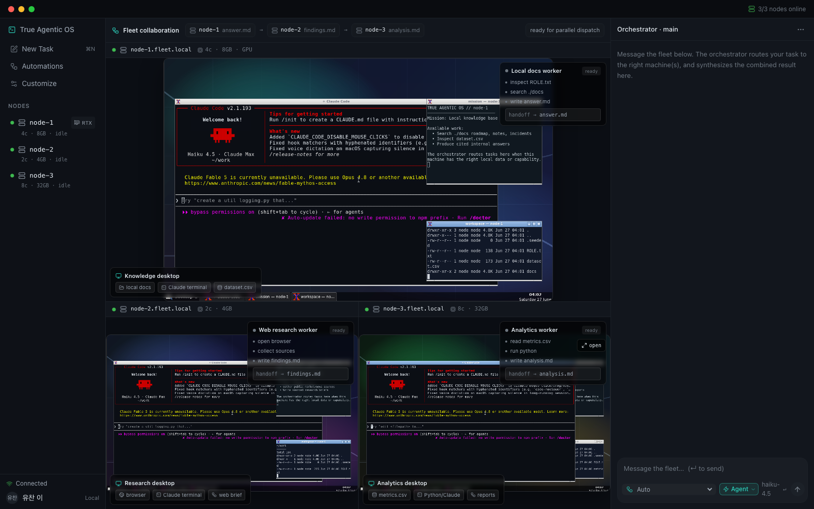
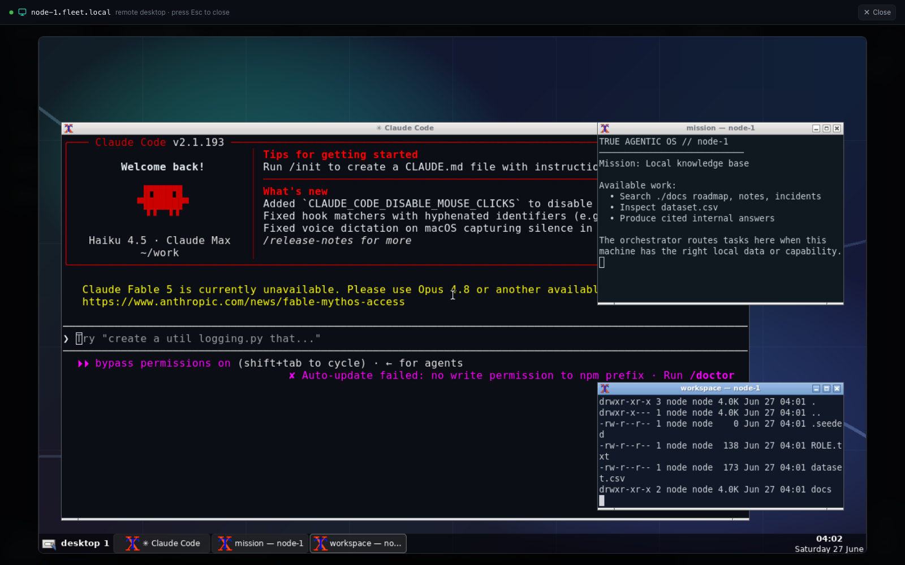
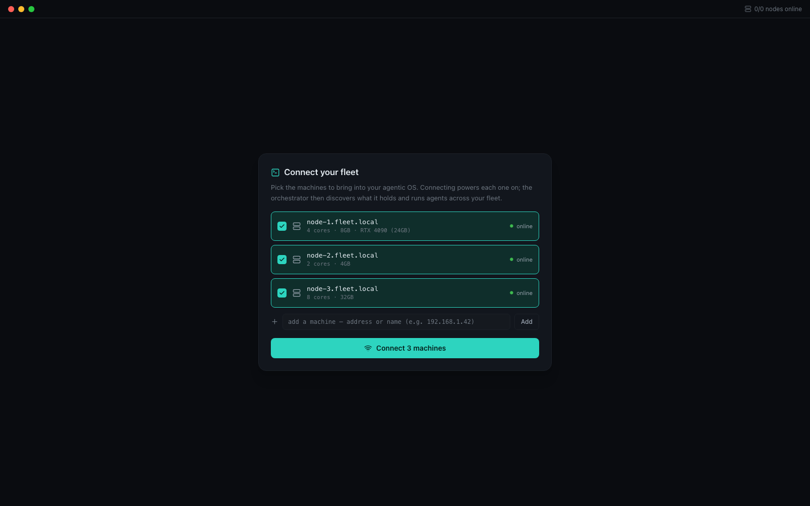
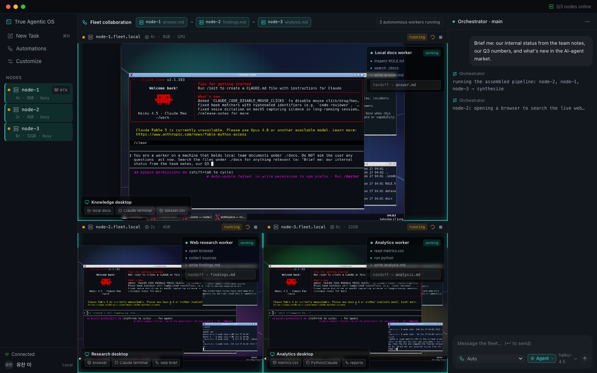
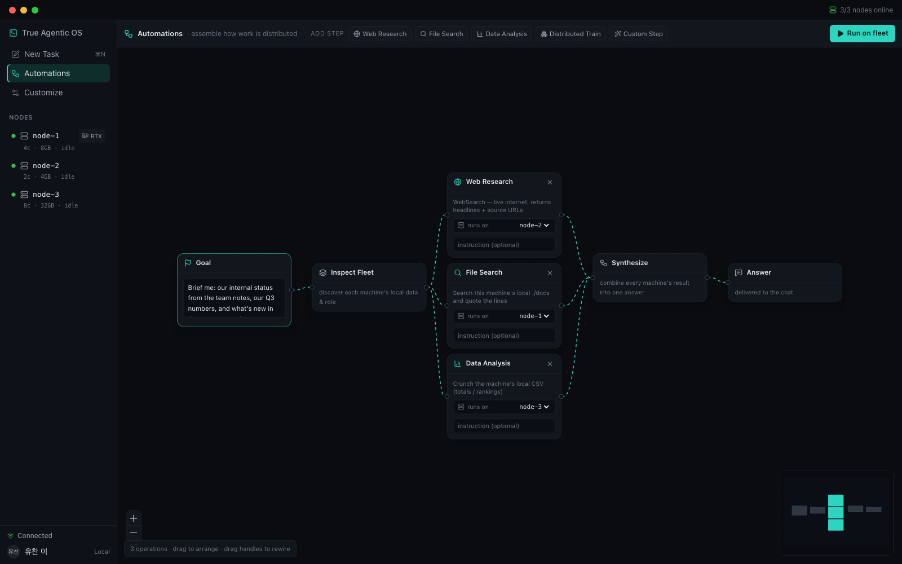
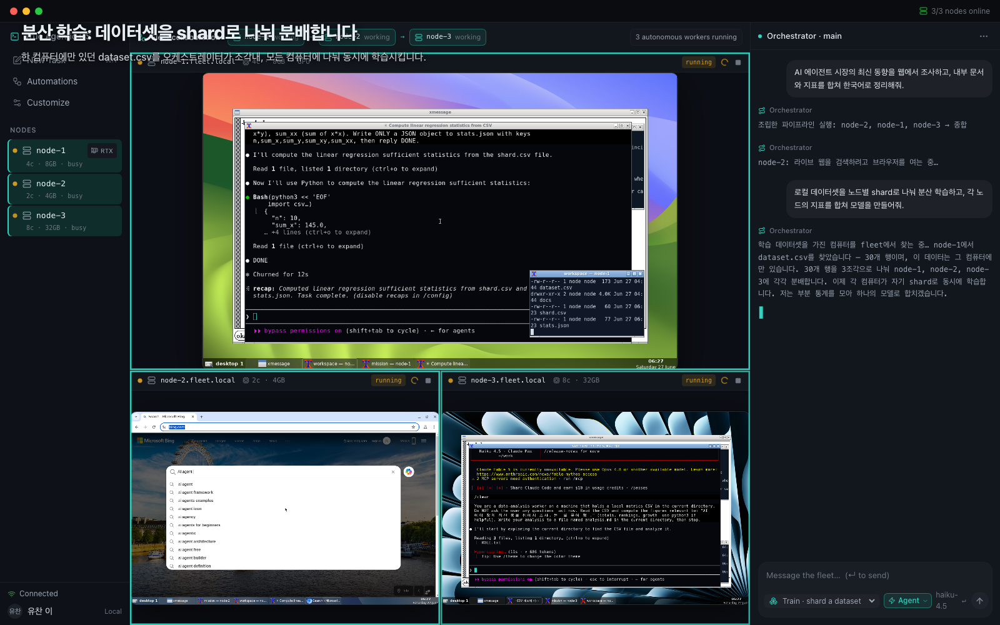
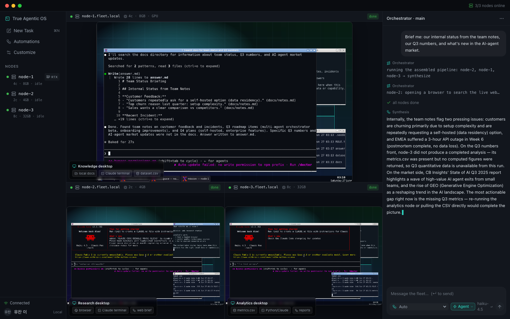
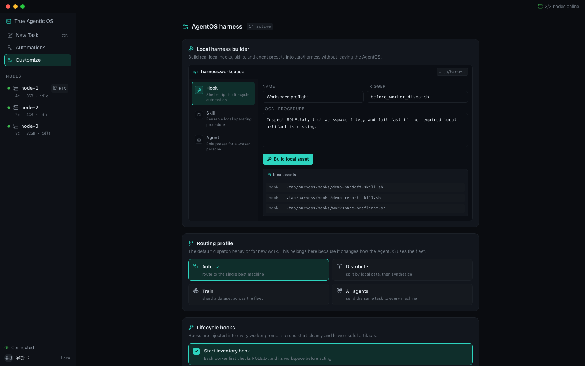

<h1 align="center">True Agentic OS</h1>

<p align="center">
  <a href="https://github.com/yc9954/true-agentic-os"></a>
  <a href="https://github.com/yc9954/true-agentic-os/actions/workflows/ci.yml"></a>
  
  
  
  <a href="LICENSE"></a>
</p>

<p align="center">
  <sub><a href="docs/readme/README.ko.md">한국어</a></sub>
</p>

<p align="center">
  <strong>One orchestrator. A fleet of real machines. Every agent works on a screen you can watch.</strong><br/>
  True Agentic OS is a desktop-style web app in which one orchestrator runs Claude Code across a fleet of<br/>
  independent Linux machines, routes each task to the machine that holds the right data or hardware,<br/>
  streams every desktop live into one window, and synthesizes the partial results into a single briefing.
</p>

<h3 align="center"><a href="#getting-started"><ins>Getting started</ins></a> · <a href="docs/media/demo-short.mp4">Watch the 60-second demo</a></h3>

<p align="center">
  
</p>

## Features

<table>
<tr>
<td width="50%" valign="middle">

### Machines, not chat tabs

Each node is a real Linux desktop: wallpaper, panel, a terminal running Claude Code, and its own workspace. The fleet view tiles every desktop tmux-style and streams them live over noVNC.

Click a tile to open that machine full-screen and talk to its agent directly.

</td>
<td width="50%">
  
</td>
</tr>
<tr>
<td width="50%" valign="middle">

### Connect a fleet, power it on

Pick the machines to bring into the OS. Connecting powers each one on; the orchestrator then discovers what it holds and shows its screen as soon as the desktop is up.

Add a machine by name or address and it is provisioned as a new node with its own noVNC port.

</td>
<td width="50%">
  
</td>
</tr>
<tr>
<td width="50%" valign="middle">

### Routing by data and hardware

A deterministic router, not a model, decides placement. `Auto` picks the idle machine whose capabilities match (a training prompt goes to the node with a GPU). `Distribute` asks the orchestrator to inspect every node's local files and plan one tailored sub-task per machine. `All agents` broadcasts.

You can also target one node by name.

</td>
<td width="50%">
  
</td>
</tr>
<tr>
<td width="50%" valign="middle">

### Assemble the distribution on a canvas

The Automations view is a node-based editor. Drop `Web Research`, `File Search`, `Data Analysis`, `Distributed Train` or `Custom Step` blocks, pick the machine each runs on, wire them into `Synthesize`, and hit **Run on fleet**.

The wiring you drew is the wiring that runs.

</td>
<td width="50%">
  
</td>
</tr>
<tr>
<td width="50%" valign="middle">

### A real browser on a real screen

The web-research step does not call a search API. It launches a headed Chromium on that node's desktop, types the query, opens the top result, and writes `findings.md` with titles, snippets and source URLs. You watch it happen in the tile.

</td>
<td width="50%">
  
</td>
</tr>
<tr>
<td width="50%" valign="middle">

### Distributed training without moving the data

`Train` mode finds the node that holds `dataset.csv`, shards the rows across the fleet, has every node compute sufficient statistics on its own shard with Python, and combines them into an exact least-squares model.

The raw data never leaves the machine it started on. Only five numbers per node travel back.

</td>
<td width="50%">
  
</td>
</tr>
<tr>
<td width="50%" valign="middle">

### An AgentOS harness you can edit

Hooks, agent presets, skill packs and guardrails are not cosmetic. Enabled items are injected into every worker prompt before dispatch. The harness builder writes real hook scripts and skill/agent markdown into `.tao/harness/` from the UI.

Routing profile and briefing language (English or Korean) live here too.

</td>
<td width="50%">
  
</td>
</tr>
</table>

**Also included**

- **Live orchestrator narration**: planning, sharding decisions and the final synthesis stream token-by-token into the chat from the host's own `claude`.
- **Precise completion detection**: pipeline steps finish when their output file (`findings.md`, `answer.md`, `analysis.md`, `stats.json`) actually appears; free-form tasks use a change-then-quiet heuristic with a hard timeout.
- **Seeded roles**: node-1 holds team docs and a dataset, node-2 is the web-research station, node-3 holds regional metrics. Each desktop shows a mission window describing what it is for.
- **Playwright demo scripts** in `demo/` that drive the UI, capture stills and record the videos in `docs/media/`.
- **Everything bound to loopback by default**: the API, the WebSocket stream and every noVNC port.

---

## How it works

```text
UI (React, Tailwind, React Flow) ──REST / WebSocket──▶ Orchestrator (Node 22, TypeScript)
                                                        │  dockerode + docker CLI
                                                        │  host `claude` for planning + synthesis
                                                        ▼
                     ┌──────────────────┬──────────────────┬──────────────────┐
                     │ node-1           │ node-2           │ node-3           │   Docker containers
                     │ Xvnc · openbox   │ Xvnc · openbox   │ Xvnc · openbox   │   (tao-desktop image)
                     │ Claude Code TUI  │ Claude Code TUI  │ Claude Code TUI  │
                     │ ./docs, dataset  │ headed Chromium  │ metrics.csv      │
                     └───── noVNC ──────┴───── noVNC ──────┴───── noVNC ──────┘
                                     ▲ each desktop streams into an <iframe>
```

1. **Connect.** The UI lists every discoverable machine. Connecting starts the container; the orchestrator polls Docker until the Claude terminal window exists, then flips the tile from "powering on" to the live screen.
2. **Route.** `POST /api/tasks` goes through `router.ts`: capability filter, idle-only, least-loaded, deterministic tie-break. Distribute, Train and canvas pipelines take their own paths in `server.ts`.
3. **Dispatch.** A task is typed into the node's on-screen Claude Code terminal with `xdotool`, preceded by the active harness preamble. The work is visible on the desktop because that is where it runs.
4. **Watch.** A per-node watcher polls the workspace over `docker exec` and marks the node done when the expected artifact lands.
5. **Synthesize.** The orchestrator reads each node's newest file, and the host `claude` writes one briefing in the configured language.

<details>
<summary><strong>Distributed training, in full</strong></summary>

1. The orchestrator reads `dataset.csv` from every idle node and keeps the first hit (node-1 in the demo).
2. Rows are dealt round-robin into K shards, one per online node, and written to each node as `shard.csv`. Any stale `stats.json` is blanked so a fresh result is required.
3. Every node is told: compute `n, sum_x, sum_y, sum_xy, sum_xx` over `shard.csv` with `python3`, write `stats.json`, reply DONE.
4. `watchForFile` waits for JSON to appear (150 s timeout, and a node that times out is named in the briefing).
5. The orchestrator sums the statistics and solves the closed-form least-squares slope and intercept. Because the sums are additive, the result is exactly what training on the whole dataset would give.

</details>

<details>
<summary><strong>What the harness preamble injects</strong></summary>

With the defaults on, every dispatched prompt is prefixed with one paragraph that states the node's identity, the agent presets in the fleet, the three lifecycle hooks (inventory first, artifact before handoff, keep outputs in `~/work`), four skills (cite local files, source web research, use `python3`, write markdown artifacts) and three guardrails (no mid-run questions, require an output file, concise handoff). Toggle any of them in Customize and the next dispatch reflects it.

</details>

---

## Tech stack

<p>
  <kbd>React&nbsp;18</kbd> &nbsp; <kbd>TypeScript&nbsp;5</kbd> &nbsp; <kbd>Vite&nbsp;5</kbd> &nbsp; <kbd>Tailwind&nbsp;3</kbd> &nbsp; <kbd>React&nbsp;Flow&nbsp;12</kbd> &nbsp; <kbd>lucide</kbd> &nbsp;
  <kbd>Node&nbsp;22</kbd> &nbsp; <kbd>Express</kbd> &nbsp; <kbd>ws</kbd> &nbsp; <kbd>dockerode</kbd> &nbsp;
  <kbd>Ubuntu&nbsp;22.04</kbd> &nbsp; <kbd>TigerVNC&nbsp;+&nbsp;openbox&nbsp;+&nbsp;tint2</kbd> &nbsp; <kbd>noVNC&nbsp;/&nbsp;websockify</kbd> &nbsp; <kbd>xdotool</kbd> &nbsp;
  <kbd>Claude&nbsp;Code&nbsp;CLI</kbd> &nbsp; <kbd>Playwright&nbsp;Chromium</kbd>
</p>

---

## Getting started

**Prerequisites**

- Docker with a reachable socket (Docker Desktop, Colima and OrbStack are auto-detected) and the `docker` CLI on `PATH`.
- Node 22+ and npm.
- Claude Code installed and logged in on the host (`claude` on `PATH`). The orchestrator uses it for planning and synthesis, and its OAuth credentials are what the nodes run with.

```bash
git clone https://github.com/yc9954/true-agentic-os.git
cd true-agentic-os

make setup        # npm ci in orchestrator/, ui/, demo/
make image        # docker build -t tao-desktop:latest ./node-desktop   (~5 min the first time)
make creds        # copies your Claude Code credentials into secrets/ (git-ignored)
make fleet-up     # provisions node-1..3, powered off
make orchestrator # builds the UI, then serves everything on http://127.0.0.1:4000
```

Open <http://127.0.0.1:4000>, tick the three machines and press **Connect**. The desktops take 10 to 20 seconds to boot. Then type a task, pick a mode in the composer, and watch.

| Process | Port | Notes |
| --- | --- | --- |
| Orchestrator (API, WebSocket, built UI) | `4000` | `HOST` / `PORT`; loopback by default |
| Vite dev server (`make dev`) | `5173` | proxies `/api` and `/stream` to `4000` |
| node-1 / node-2 / node-3 desktops (noVNC) | `6081` / `6082` / `6083` | `TAO_VNC_BASE_PORT + N`; loopback by default |

**Configuration** is entirely environment variables. Copy [`.env.example`](.env.example) and export what you change. The ones people touch:

| Variable | Default | What it does |
| --- | --- | --- |
| `TAO_LANG` | `en` | Language of the orchestrator's narration and syntheses (`en` or `ko`). Also switchable in Customize. |
| `STREAM_MODEL` | `claude-haiku-4-5-20251001` | Model the host `claude` uses for planning and synthesis. |
| `CLAUDE_MODEL` | `claude-haiku-4-5-20251001` | Model started inside each node's terminal. |
| `HOST`, `TAO_VNC_BIND` | `127.0.0.1` | Where the API and the noVNC ports are published. |
| `TAO_CREDS_PATH` | `secrets/claude-credentials.json` | Credentials mounted read-only into every node. |

On Linux, `make creds` copies `~/.claude/.credentials.json`; on macOS it reads the Keychain entry. If you prefer an API key, put `ANTHROPIC_API_KEY` in the node environment instead and skip the mount.

**Try these**

```text
Auto        → "Summarize our incident history from the docs."          (lands on node-1, the docs holder)
Auto        → "Fine-tune a small model on the local dataset."           (GPU keyword → node-1, the declared GPU)
Distribute  → "Brief me: internal status, Q3 numbers, and what's new in the AI-agent market."
Train       → "Shard the local dataset across the fleet and fit a model."
Automations → Run the pre-wired Web Research + File Search + Data Analysis pipeline
```

---

## Building and testing

```bash
make typecheck                 # tsc --noEmit in orchestrator/ and ui/
npm --prefix ui run build      # typecheck + vite build → ui/dist
make demo                      # Playwright: drives the UI and records docs/media-style clips
```

CI runs the orchestrator typecheck, the UI build and a no-push Docker build of the node image. See [`.github/workflows/ci.yml`](.github/workflows/ci.yml). There is no test suite yet; the demo scripts in `demo/` (`verify.mjs`, `run-short-demo.mjs`) double as end-to-end checks against a live fleet.

---

## Screens

| View | What it does |
| --- | --- |
| **Connect** | Lists discoverable machines with declared cores, RAM and GPU. Add one by address; connect to power them on. |
| **Fleet** | Every desktop tiled live, a collaboration strip showing who is working on what, and the orchestrator chat with the mode picker (`Auto`, `Distribute`, `Train`, `All agents`, or a node). |
| **Remote desktop** | One node full-screen with a direct chat to that agent only. `Esc` closes. |
| **Automations** | The canvas. Goal → Inspect Fleet → operation blocks → Synthesize → Answer. Each block picks its machine and takes an optional custom instruction. |
| **Customize** | Harness builder, routing profile, briefing language, lifecycle hooks, agent presets, skill packs, guardrails, and a read-only view of connected roles. |

---

## Repository structure

| Path | What lives there |
| --- | --- |
| `orchestrator/` | Node 22 + TypeScript server. `server.ts` (API, WebSocket, dispatch modes, synthesis), `router.ts` (deterministic placement), `node.ts` (Docker, workspace I/O, xdotool dispatch, watchers), `registry.ts` (fleet state), `i18n.ts` (narration strings), `config.ts` (env). |
| `ui/` | Vite + React SPA. `App.tsx` (fleet view, chat, remote desktop), `Automations.tsx` (React Flow canvas), `Customize.tsx` (harness), `useFleet.ts` (WebSocket state). |
| `node-desktop/` | The `tao-desktop` image: Dockerfile, `desktop-entrypoint.sh` (boots Xvnc, openbox, the Claude terminal, seeds roles), `agent-browse.mjs` (visible Chromium search), noVNC `clean.html`, wallpapers. |
| `scripts/fleet-desktop.sh` | `up` / `down` / `status` / `restart` for the three demo nodes. |
| `demo/` | Playwright scripts: `run-short-demo.mjs`, `run-demo.mjs`, `run-korean-demo.mjs`, `capture-ppt-scenes.mjs`, `verify.mjs`. |
| `docs/` | README assets, the Korean README, and the recorded demo clips. |
| `.tao/harness/` | Where the Customize builder writes hooks, skills and agent presets (contents git-ignored). |
| `Makefile`, `.env.example` | One-command workflows and every configurable value. |

---

## Project status

Stated plainly, because the distinction matters for anyone reading the code.

**Working today.** Three-node desktop fleet in Docker; live noVNC tiles and full-screen focus; Auto, manual, broadcast, Distribute, Train and canvas-pipeline dispatch; harness injection and the harness builder; visible Chromium web research; exact distributed least-squares training; streamed planning and synthesis in English or Korean; machines added through the UI survive an orchestrator restart.

**Simulated on purpose.** The nodes are containers on one host. Cores, RAM and the GPU are *declared* values in `config.ts` so the router has something to reason about; nothing is measured. The three roles and their local files are seeded by the entrypoint. "Training" is linear regression on a 30-row CSV, chosen because the sufficient statistics make the distributed result provably exact.

**Security posture.** Every node runs Claude Code with `--dangerously-skip-permissions`, the desktops have no VNC password, and the API has no authentication. That is why everything binds to loopback by default and the WebSocket rejects cross-origin connections. Do not expose the ports beyond a trusted network. All nodes share one copy of your OAuth credentials; concurrent token refreshes can race, and an API key is the more robust option for a longer-lived fleet. Web findings are untrusted text that flows into the synthesis prompt.

**Out of scope, for now.** Real remote machines (the `endpoint` field is already there, the transport is not); measured capabilities; authentication; persistence of tasks across restarts; a test suite. Issues and PRs on any of these are welcome.

---

## License

[MIT](LICENSE).
