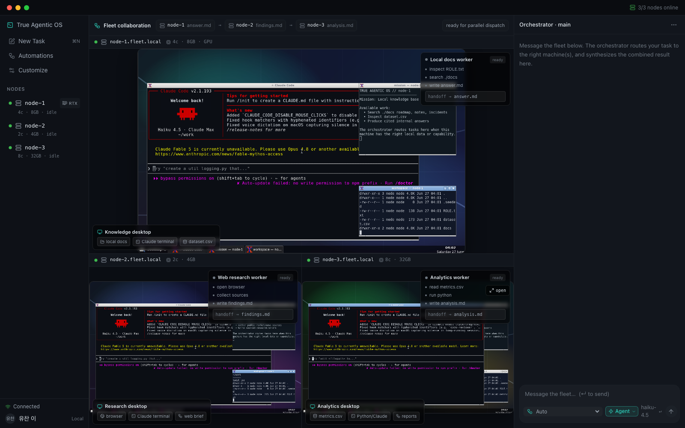
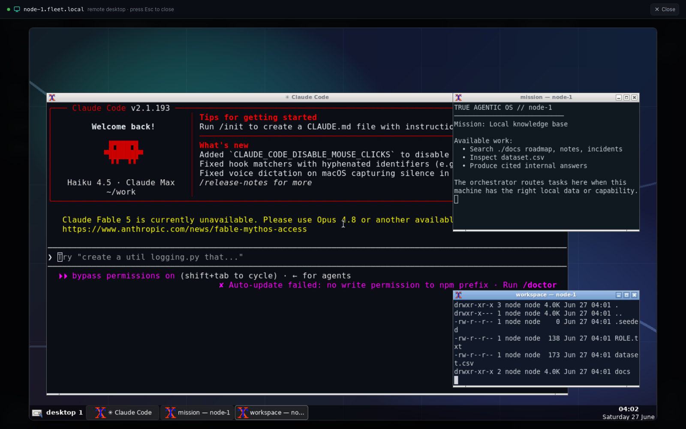
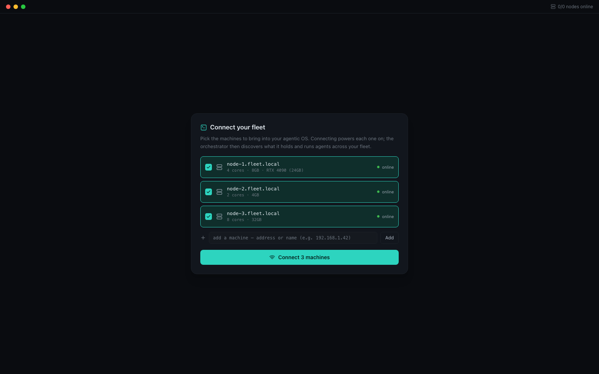
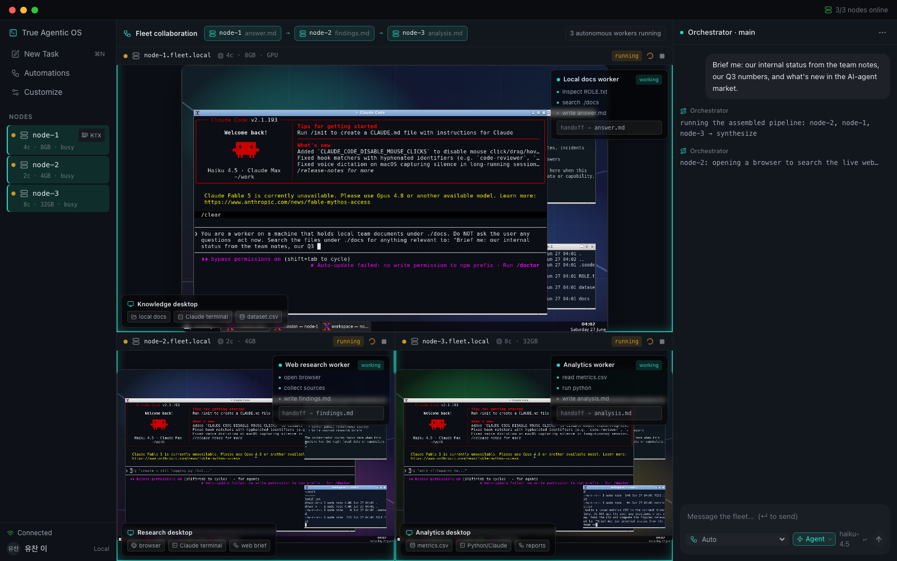
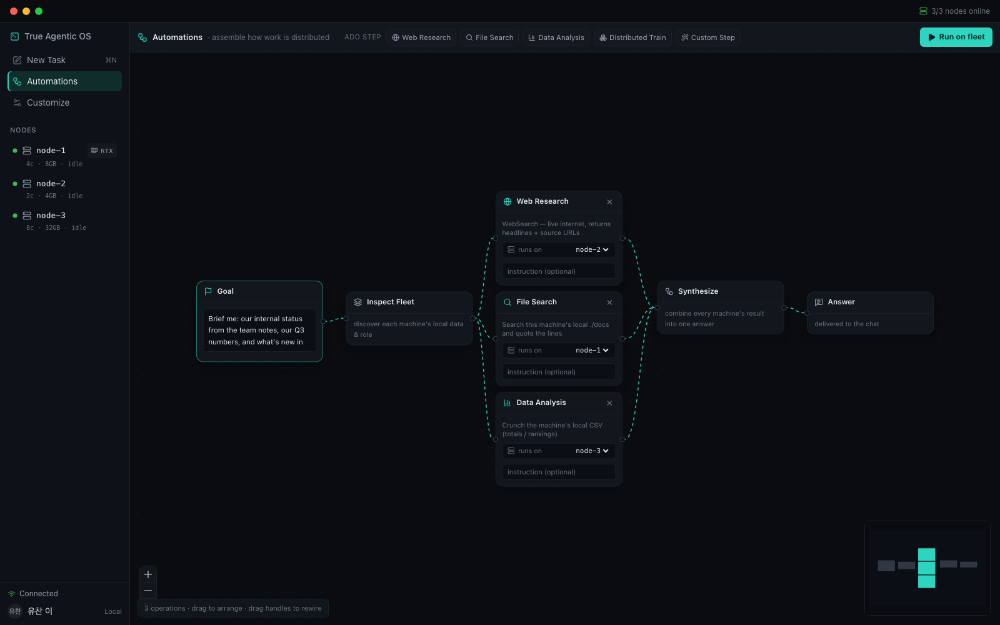
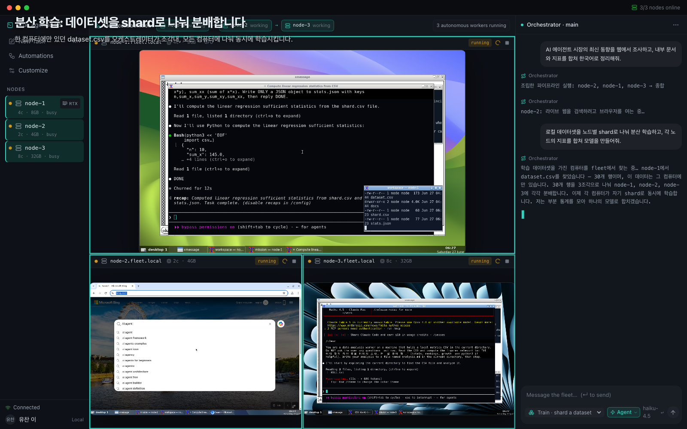
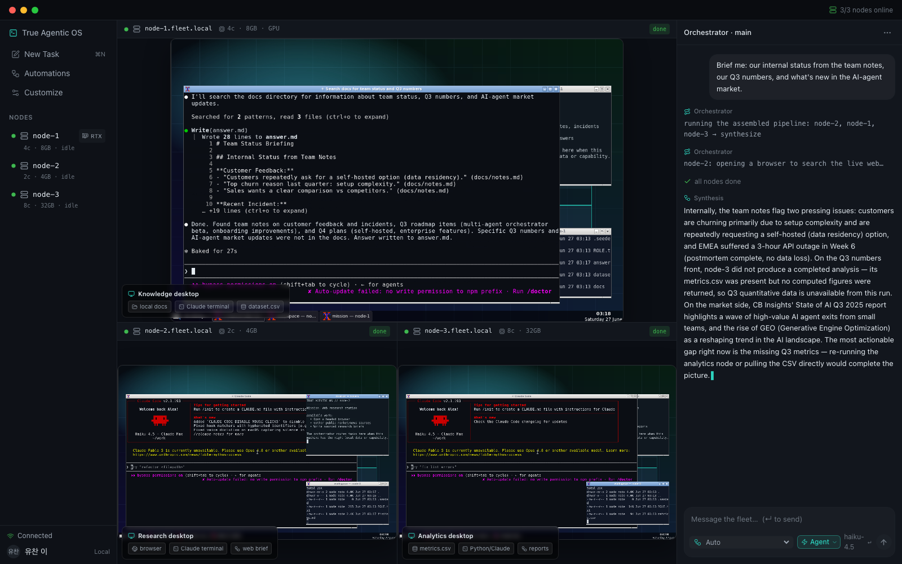
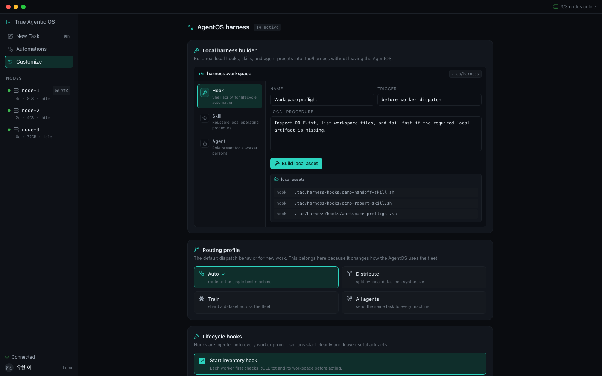

<h1 align="center">True Agentic OS</h1>

<p align="center">
  <a href="https://github.com/yc9954/true-agentic-os"></a>
  <a href="https://github.com/yc9954/true-agentic-os/actions/workflows/ci.yml"></a>
  
  
  
  <a href="../../LICENSE"></a>
</p>

<p align="center">
  <sub><a href="../../README.md">English</a></sub>
</p>

<p align="center">
  <strong>오케스트레이터 하나. 진짜 컴퓨터로 이루어진 fleet. 모든 에이전트가 눈에 보이는 화면 위에서 일합니다.</strong><br/>
  True Agentic OS는 하나의 오케스트레이터가 여러 대의 독립된 리눅스 머신에서 Claude Code를 굴리는 데스크톱형 웹 앱입니다.<br/>
  각 작업을 알맞은 데이터·하드웨어를 가진 컴퓨터로 보내고, 모든 데스크톱을 한 창에 라이브로 띄우고,<br/>
  부분 결과를 하나의 브리핑으로 종합합니다.
</p>

<h3 align="center"><a href="#시작하기"><ins>시작하기</ins></a> · <a href="../media/demo-korean.mp4">한국어 데모 영상</a></h3>

<p align="center">
  
</p>

## 기능

<table>
<tr>
<td width="50%" valign="middle">

### 채팅 탭이 아니라 컴퓨터

각 노드는 진짜 리눅스 데스크톱입니다. 배경화면, 패널, Claude Code가 돌아가는 터미널, 자기만의 작업 폴더가 있습니다. fleet 뷰는 모든 데스크톱을 tmux처럼 타일링해 noVNC로 실시간 스트리밍합니다.

타일을 클릭하면 그 컴퓨터가 전체 화면으로 열리고, 그 에이전트와 직접 대화할 수 있습니다.

</td>
<td width="50%">
  
</td>
</tr>
<tr>
<td width="50%" valign="middle">

### fleet을 연결하고 전원을 켭니다

OS에 들일 컴퓨터를 고릅니다. 연결하면 각 머신에 전원이 들어오고, 오케스트레이터가 그 머신이 가진 것을 파악한 뒤 데스크톱이 뜨는 즉시 화면을 보여줍니다.

이름이나 주소로 머신을 추가하면 자기 noVNC 포트를 가진 새 노드로 프로비저닝됩니다.

</td>
<td width="50%">
  
</td>
</tr>
<tr>
<td width="50%" valign="middle">

### 데이터와 하드웨어 기준 라우팅

배치를 정하는 건 모델이 아니라 결정적(deterministic) 라우터입니다. `Auto`는 요구 능력에 맞는 유휴 머신을 고릅니다(학습 프롬프트는 GPU가 있는 노드로). `Distribute`는 오케스트레이터가 모든 노드의 로컬 파일을 들여다보고 머신별 맞춤 하위 작업을 하나씩 계획합니다. `All agents`는 브로드캐스트입니다.

노드 이름을 지정해 한 대에만 보낼 수도 있습니다.

</td>
<td width="50%">
  
</td>
</tr>
<tr>
<td width="50%" valign="middle">

### 캔버스에서 분배를 조립합니다

Automations 뷰는 노드 기반 에디터입니다. `Web Research`, `File Search`, `Data Analysis`, `Distributed Train`, `Custom Step` 블록을 놓고, 각 블록이 돌아갈 머신을 고르고, `Synthesize`에 연결한 뒤 **Run on fleet**을 누릅니다.

그린 배선이 그대로 실행됩니다.

</td>
<td width="50%">
  
</td>
</tr>
<tr>
<td width="50%" valign="middle">

### 진짜 화면 위의 진짜 브라우저

웹 리서치 단계는 검색 API를 호출하지 않습니다. 그 노드의 데스크톱에 헤드가 있는 Chromium을 띄워 검색어를 입력하고, 상위 결과를 열고, 제목·요약·출처 URL을 담은 `findings.md`를 씁니다. 타일에서 그 과정을 그대로 봅니다.

</td>
<td width="50%">
  
</td>
</tr>
<tr>
<td width="50%" valign="middle">

### 데이터를 옮기지 않는 분산 학습

`Train` 모드는 `dataset.csv`를 가진 노드를 찾아 행을 fleet 전체에 shard로 나누고, 각 노드가 자기 shard에서 Python으로 충분통계를 계산하게 한 뒤, 정확한 최소제곱 모델로 합칩니다.

원본 데이터는 처음 있던 머신을 떠나지 않습니다. 노드당 숫자 다섯 개만 돌아옵니다.

</td>
<td width="50%">
  
</td>
</tr>
<tr>
<td width="50%" valign="middle">

### 직접 편집하는 AgentOS 하네스

훅, 에이전트 프리셋, 스킬 팩, 가드레일은 장식이 아닙니다. 켜진 항목은 디스패치 전에 모든 워커 프롬프트에 주입됩니다. 하네스 빌더는 UI에서 실제 훅 스크립트와 스킬/에이전트 마크다운을 `.tao/harness/`에 씁니다.

라우팅 프로필과 브리핑 언어(영어/한국어)도 여기서 고릅니다.

</td>
<td width="50%">
  
</td>
</tr>
</table>

**그 밖에**

- **오케스트레이터의 라이브 내레이션**: 계획, shard 분배 결정, 최종 종합이 호스트의 `claude`에서 토큰 단위로 채팅에 흘러 들어옵니다.
- **정확한 완료 감지**: 파이프라인 단계는 산출 파일(`findings.md`, `answer.md`, `analysis.md`, `stats.json`)이 실제로 생길 때 끝납니다. 자유형 작업은 "변화 후 정지" 휴리스틱과 하드 타임아웃을 씁니다.
- **역할이 심어진 노드**: node-1은 팀 문서와 데이터셋, node-2는 웹 리서치 스테이션, node-3는 지역별 지표를 가집니다. 각 데스크톱에는 자기 역할을 설명하는 미션 창이 떠 있습니다.
- **Playwright 데모 스크립트**(`demo/`)가 UI를 조작하고 스틸을 찍고 `docs/media/`의 영상을 녹화합니다.
- **기본값은 전부 loopback 바인딩**: API, WebSocket 스트림, 모든 noVNC 포트.

---

## 동작 원리

```text
UI (React, Tailwind, React Flow) ──REST / WebSocket──▶ 오케스트레이터 (Node 22, TypeScript)
                                                        │  dockerode + docker CLI
                                                        │  계획·종합에는 호스트의 `claude`
                                                        ▼
                     ┌──────────────────┬──────────────────┬──────────────────┐
                     │ node-1           │ node-2           │ node-3           │   Docker 컨테이너
                     │ Xvnc · openbox   │ Xvnc · openbox   │ Xvnc · openbox   │   (tao-desktop 이미지)
                     │ Claude Code TUI  │ Claude Code TUI  │ Claude Code TUI  │
                     │ ./docs, dataset  │ headed Chromium  │ metrics.csv      │
                     └───── noVNC ──────┴───── noVNC ──────┴───── noVNC ──────┘
                                     ▲ 각 데스크톱이 <iframe>으로 스트리밍
```

1. **연결.** UI가 발견 가능한 머신을 나열합니다. 연결하면 컨테이너가 시작되고, 오케스트레이터는 Claude 터미널 창이 생길 때까지 Docker를 폴링한 뒤 타일을 "powering on"에서 라이브 화면으로 바꿉니다.
2. **라우팅.** `POST /api/tasks`는 `router.ts`를 거칩니다: 능력 필터, 유휴 노드만, 최소 부하, 결정적 타이브레이크. Distribute·Train·캔버스 파이프라인은 `server.ts`에서 각자의 경로를 탑니다.
3. **디스패치.** 작업은 활성 하네스 프리앰블을 앞에 붙여 `xdotool`로 노드 화면의 Claude Code 터미널에 타이핑됩니다. 일이 데스크톱에서 보이는 이유는 실제로 거기서 실행되기 때문입니다.
4. **감시.** 노드별 워처가 `docker exec`로 작업 폴더를 폴링하고, 기대한 산출물이 생기면 그 노드를 완료로 표시합니다.
5. **종합.** 오케스트레이터가 각 노드의 최신 파일을 읽고, 호스트 `claude`가 설정된 언어로 브리핑 하나를 씁니다.

<details>
<summary><strong>분산 학습 전 과정</strong></summary>

1. 오케스트레이터가 모든 유휴 노드에서 `dataset.csv`를 읽고 첫 번째 히트를 씁니다(데모에서는 node-1).
2. 행을 온라인 노드 수 K개의 shard로 라운드로빈 분배해 각 노드에 `shard.csv`로 씁니다. 오래된 `stats.json`은 비워서 새 결과를 강제합니다.
3. 모든 노드에 지시합니다: `python3`로 `shard.csv`의 `n, sum_x, sum_y, sum_xy, sum_xx`를 계산하고 `stats.json`을 쓴 뒤 DONE이라고 답하라.
4. `watchForFile`이 JSON이 나타나길 기다립니다(150초 타임아웃, 시간을 넘긴 노드는 브리핑에 이름이 적힙니다).
5. 오케스트레이터가 통계를 합산해 닫힌 형태의 최소제곱 기울기·절편을 풉니다. 합은 가법적이므로 전체 데이터셋으로 학습한 결과와 정확히 같습니다.

</details>

<details>
<summary><strong>하네스 프리앰블이 주입하는 것</strong></summary>

기본값이 모두 켜져 있으면, 디스패치되는 모든 프롬프트 앞에 한 문단이 붙습니다: 노드 정체성, fleet의 에이전트 프리셋, 세 가지 라이프사이클 훅(먼저 인벤토리, 핸드오프 전 산출물, `~/work`에 결과 유지), 네 가지 스킬(로컬 파일 인용, 웹 리서치 출처, `python3` 사용, 마크다운 산출물), 세 가지 가드레일(실행 중 질문 금지, 산출 파일 필수, 간결한 핸드오프). Customize에서 아무거나 끄면 다음 디스패치부터 반영됩니다.

</details>

---

## 기술 스택

<p>
  <kbd>React&nbsp;18</kbd> &nbsp; <kbd>TypeScript&nbsp;5</kbd> &nbsp; <kbd>Vite&nbsp;5</kbd> &nbsp; <kbd>Tailwind&nbsp;3</kbd> &nbsp; <kbd>React&nbsp;Flow&nbsp;12</kbd> &nbsp; <kbd>lucide</kbd> &nbsp;
  <kbd>Node&nbsp;22</kbd> &nbsp; <kbd>Express</kbd> &nbsp; <kbd>ws</kbd> &nbsp; <kbd>dockerode</kbd> &nbsp;
  <kbd>Ubuntu&nbsp;22.04</kbd> &nbsp; <kbd>TigerVNC&nbsp;+&nbsp;openbox&nbsp;+&nbsp;tint2</kbd> &nbsp; <kbd>noVNC&nbsp;/&nbsp;websockify</kbd> &nbsp; <kbd>xdotool</kbd> &nbsp;
  <kbd>Claude&nbsp;Code&nbsp;CLI</kbd> &nbsp; <kbd>Playwright&nbsp;Chromium</kbd>
</p>

---

## 시작하기

**사전 준비**

- 소켓에 접근 가능한 Docker(Docker Desktop, Colima, OrbStack 자동 감지)와 `PATH` 위의 `docker` CLI.
- Node 22 이상과 npm.
- 호스트에 설치되고 로그인된 Claude Code(`PATH` 위의 `claude`). 오케스트레이터가 계획·종합에 쓰고, 그 OAuth 자격 증명으로 노드들이 실행됩니다.

```bash
git clone https://github.com/yc9954/true-agentic-os.git
cd true-agentic-os

make setup        # orchestrator/, ui/, demo/ 에서 npm ci
make image        # docker build -t tao-desktop:latest ./node-desktop   (처음엔 5분 정도)
make creds        # Claude Code 자격 증명을 secrets/ 로 복사 (git-ignored)
make fleet-up     # node-1..3 프로비저닝, 전원은 꺼진 상태
make orchestrator # UI 빌드 후 http://127.0.0.1:4000 에서 전부 서빙
```

<http://127.0.0.1:4000>을 열고 세 머신을 체크한 뒤 **Connect**를 누르세요. 데스크톱 부팅에 10~20초가 걸립니다. 그다음 작업을 입력하고 컴포저에서 모드를 고른 뒤 지켜보면 됩니다. 브리핑을 한국어로 받으려면 `TAO_LANG=ko`로 실행하거나 Customize에서 한국어를 고르세요.

| 프로세스 | 포트 | 비고 |
| --- | --- | --- |
| 오케스트레이터 (API, WebSocket, 빌드된 UI) | `4000` | `HOST` / `PORT`; 기본 loopback |
| Vite 개발 서버 (`make dev`) | `5173` | `/api`, `/stream`을 `4000`으로 프록시 |
| node-1 / node-2 / node-3 데스크톱 (noVNC) | `6081` / `6082` / `6083` | `TAO_VNC_BASE_PORT + N`; 기본 loopback |

**설정**은 전부 환경 변수입니다. [`.env.example`](../../.env.example)을 복사해 바꾼 값만 export 하세요. 자주 만지는 것들:

| 변수 | 기본값 | 역할 |
| --- | --- | --- |
| `TAO_LANG` | `en` | 오케스트레이터 내레이션과 종합의 언어(`en` 또는 `ko`). Customize에서도 전환 가능. |
| `STREAM_MODEL` | `claude-haiku-4-5-20251001` | 호스트 `claude`가 계획·종합에 쓰는 모델. |
| `CLAUDE_MODEL` | `claude-haiku-4-5-20251001` | 각 노드 터미널 안에서 시작되는 모델. |
| `HOST`, `TAO_VNC_BIND` | `127.0.0.1` | API와 noVNC 포트를 어디에 공개할지. |
| `TAO_CREDS_PATH` | `secrets/claude-credentials.json` | 모든 노드에 읽기 전용으로 마운트되는 자격 증명. |

Linux에서는 `make creds`가 `~/.claude/.credentials.json`을 복사하고, macOS에서는 키체인 항목을 읽습니다. API 키를 쓰고 싶다면 노드 환경에 `ANTHROPIC_API_KEY`를 넣고 마운트를 생략하세요.

**이런 걸 해보세요**

```text
Auto        → "문서에서 우리 인시던트 이력을 요약해줘."                    (문서를 가진 node-1로)
Auto        → "로컬 데이터셋으로 작은 모델을 파인튜닝해줘."                (학습 키워드 → GPU가 선언된 node-1)
Distribute  → "내부 현황, 3분기 숫자, AI 에이전트 시장의 새 소식을 브리핑해줘."
Train       → "로컬 데이터셋을 fleet에 shard로 나눠 모델을 학습해줘."
Automations → 미리 배선된 Web Research + File Search + Data Analysis 파이프라인 실행
```

---

## 빌드와 테스트

```bash
make typecheck                 # orchestrator/, ui/ 에서 tsc --noEmit
npm --prefix ui run build      # 타입체크 + vite build → ui/dist
make demo                      # Playwright: UI를 조작해 docs/media 스타일의 클립을 녹화
```

CI는 오케스트레이터 타입체크, UI 빌드, 노드 이미지의 no-push Docker 빌드를 돌립니다. [`.github/workflows/ci.yml`](../../.github/workflows/ci.yml)을 보세요. 아직 테스트 스위트는 없습니다. `demo/`의 스크립트(`verify.mjs`, `run-short-demo.mjs`)가 살아 있는 fleet에 대한 엔드투엔드 점검을 겸합니다.

---

## 화면

| 뷰 | 하는 일 |
| --- | --- |
| **Connect** | 발견 가능한 머신을 선언된 코어·RAM·GPU와 함께 나열. 주소로 추가하고, 연결하면 전원이 켜짐. |
| **Fleet** | 모든 데스크톱 라이브 타일, 누가 무엇을 하는지 보여주는 협업 스트립, 모드 선택기(`Auto`, `Distribute`, `Train`, `All agents`, 또는 특정 노드)가 있는 오케스트레이터 채팅. |
| **Remote desktop** | 한 노드 전체 화면과 그 에이전트에게만 가는 직접 채팅. `Esc`로 닫기. |
| **Automations** | 캔버스. Goal → Inspect Fleet → 연산 블록 → Synthesize → Answer. 각 블록은 머신을 고르고 선택적 커스텀 지시를 받음. |
| **Customize** | 하네스 빌더, 라우팅 프로필, 브리핑 언어, 라이프사이클 훅, 에이전트 프리셋, 스킬 팩, 가드레일, 연결된 역할의 읽기 전용 뷰. |

---

## 저장소 구조

| 경로 | 내용 |
| --- | --- |
| `orchestrator/` | Node 22 + TypeScript 서버. `server.ts`(API, WebSocket, 디스패치 모드, 종합), `router.ts`(결정적 배치), `node.ts`(Docker, 작업 폴더 I/O, xdotool 디스패치, 워처), `registry.ts`(fleet 상태), `i18n.ts`(내레이션 문자열), `config.ts`(환경 변수). |
| `ui/` | Vite + React SPA. `App.tsx`(fleet 뷰, 채팅, 원격 데스크톱), `Automations.tsx`(React Flow 캔버스), `Customize.tsx`(하네스), `useFleet.ts`(WebSocket 상태). |
| `node-desktop/` | `tao-desktop` 이미지: Dockerfile, `desktop-entrypoint.sh`(Xvnc·openbox·Claude 터미널 부팅, 역할 시드), `agent-browse.mjs`(보이는 Chromium 검색), noVNC `clean.html`, 배경화면. |
| `scripts/fleet-desktop.sh` | 데모 노드 세 대의 `up` / `down` / `status` / `restart`. |
| `demo/` | Playwright 스크립트: `run-short-demo.mjs`, `run-demo.mjs`, `run-korean-demo.mjs`, `capture-ppt-scenes.mjs`, `verify.mjs`. |
| `docs/` | README 에셋, 이 한국어 README, 녹화된 데모 클립. |
| `.tao/harness/` | Customize 빌더가 훅·스킬·에이전트 프리셋을 쓰는 곳(내용은 git-ignored). |
| `Makefile`, `.env.example` | 원커맨드 워크플로와 모든 설정 값. |

---

## 프로젝트 상태

코드를 읽는 사람에게 이 구분이 중요하므로 있는 그대로 적습니다.

**지금 동작하는 것.** Docker 위의 3노드 데스크톱 fleet; 라이브 noVNC 타일과 전체 화면 포커스; Auto·수동·브로드캐스트·Distribute·Train·캔버스 파이프라인 디스패치; 하네스 주입과 하네스 빌더; 눈에 보이는 Chromium 웹 리서치; 정확한 분산 최소제곱 학습; 영어/한국어로 스트리밍되는 계획과 종합; UI에서 추가한 머신은 오케스트레이터 재시작 후에도 유지.

**의도적으로 시뮬레이션인 것.** 노드는 한 호스트 위의 컨테이너입니다. 코어·RAM·GPU는 라우터가 판단할 거리를 주려고 `config.ts`에 *선언된* 값이며, 측정된 것은 없습니다. 세 역할과 로컬 파일은 엔트리포인트가 심습니다. "학습"은 30행 CSV의 선형 회귀인데, 충분통계 덕분에 분산 결과가 증명 가능하게 정확하기 때문에 골랐습니다.

**보안 관점.** 모든 노드는 `--dangerously-skip-permissions`로 Claude Code를 돌리고, 데스크톱에는 VNC 비밀번호가 없고, API에는 인증이 없습니다. 그래서 기본값은 전부 loopback 바인딩이고 WebSocket은 cross-origin 연결을 거부합니다. 신뢰할 수 있는 네트워크 밖으로 포트를 열지 마세요. 모든 노드가 OAuth 자격 증명 한 벌을 공유하므로 동시 토큰 갱신이 경쟁할 수 있고, 오래 살아 있는 fleet에는 API 키가 더 튼튼한 선택입니다. 웹 검색 결과는 신뢰할 수 없는 텍스트로서 종합 프롬프트에 흘러 들어갑니다.

**아직 범위 밖.** 진짜 원격 머신(`endpoint` 필드는 있지만 전송 계층은 없음); 측정된 능력; 인증; 재시작 후 작업 영속성; 테스트 스위트. 이 중 무엇이든 이슈와 PR을 환영합니다.

---

## 라이선스

[MIT](../../LICENSE).
